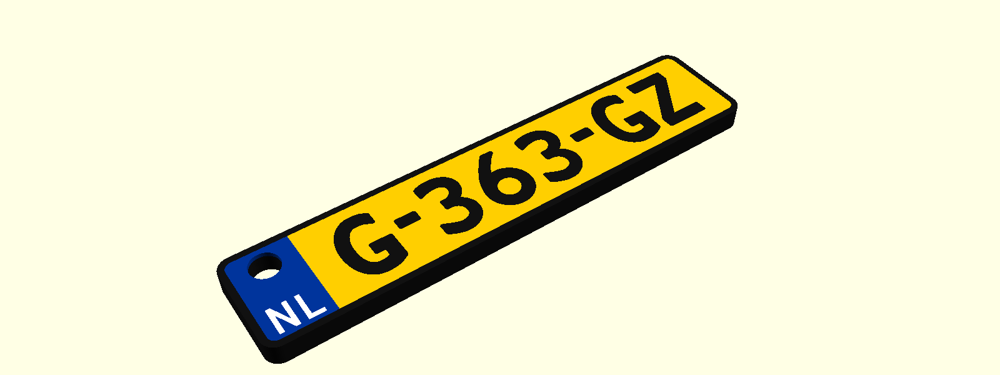
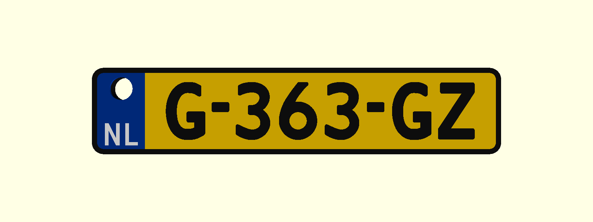

# Nederlands Kenteken Sleutelhanger (Dutch License Plate Keychain)

Een volledig parametrische, multi-color 3D-printbare Nederlandse kenteken sleutelhanger, ontworpen in **OpenSCAD** en 100% compatibel met de **MakerWorld Parametric Model Maker** en alle moderne slicers (**Bambu Studio**, **OrcaSlicer**, **PrusaSlicer**).




---

## Eigenschappen

- **MakerWorld Customizer Ready**: Gebruikers kunnen direct via hun browser op MakerWorld hun eigen kenteken invoeren, afmetingen instellen en een kant-en-klaar printbestand downloaden.
- **Echte Nederlandse Typografie**: Inclusief het officiële `Kenteken` (GAIK) font met uniforme, strakke letter- en cijfervormen, evenals de klassieke `Kenteken Smits 1951` en `2013` varianten.
- **Universele Multi-Color 3MF**: Maakt gebruik van de officiële 3MF material standaarden (geen vreemde printerprofielen of G-code foutmeldingen).
  - **Zwart** (`#111111`): Massieve achterkant, buitenrand om de plaat en de letters.
  - **Geel** (`#FFCC00`): Nederlands kentekenvlak.
  - **Blauw** (`#003399`): Europees vlak links, met afgeronde hoeken die meelopen met de buitenrand.
  - **Wit** (`#FFFFFF`): `NL` landcode.
- **Extra Stevig Sleutelgat**: Verstevigde wanden (~3.0 mm wanddikte) en massief blauw materiaal rond het gat om breuk te voorkomen.
- **Volledig Vlakke Toplaag (Flush Inlay)**: Alle kleuren liggen exact gelijk op 3.0 mm hoogte. Uitstekend geschikt voor prints met de voorkant op een *Textured PEI* of *Smooth PEI* plaat voor een spiegelglad of egaal mat resultaat zonder zichtbare laaglijnen.
- **Gecentreerde Tekst**: Het kenteken is zowel horizontaal als verticaal exact uitgelijnd in het gele veld.

---

## Mappenstructuur

```text
Nederlands-Kenteken-Sleutelhanger/
├── README.md                          # Documentatie en instructies
├── Kenteken_Sleutelhanger.scad        # Hoofd OpenSCAD parametrisch model
├── fonts/                             # Typografie bestanden & licenties
│   ├── FONTS_LICENSE.txt
│   ├── Kenteken.ttf                   # GAIK officieel Nederlands kentekenfont
│   ├── Kenteken Smits 1951.otf
│   └── Kenteken Smits 2013.otf
├── images/                            # Previews en screenshots
│   ├── preview_persp.png
│   └── preview_top.png
├── models/                            # Kant-en-klare 3D modellen
│   └── Kenteken_Sleutelhanger.3mf     # Schoon multi-color 3MF model
└── scripts/                           # Generatiescripts
    └── generate_3mf.py                # Python script om 3MF te bouwen via OpenSCAD
```

---

## Gebruik & Aanpassen

### 1. Op MakerWorld (Webbrowser)
1. Upload `Kenteken_Sleutelhanger.scad` naar MakerWorld.
2. Bezoekers klikken op **"Customize"**.
3. Pas de parameters aan:
   - `kenteken_tekst`: Jouw kenteken (bijv. `12-AB-34`, `AA-12-BB` of `1-XYZ-23`).
   - `landcode`: Landcode onder het sleutelgat (standaard `NL`).
   - `landcode_grootte`: Grootte van de landcode (standaard 3.2 mm).
   - `plaat_lengte`, `plaat_hoogte`, `totale_dikte`: Afmetingen in mm.
4. Klik op **"Generate"** om de `.3mf` direct te downloaden.

### 2. Lokaal met Python (`scripts/generate_3mf.py`)
Je kunt direct vanuit de terminal een multi-color `.3mf` genereren:

```bash
# Standaard genereren in models/Kenteken_Sleutelhanger.3mf:
python3 scripts/generate_3mf.py
```

Het bestand in `models/Kenteken_Sleutelhanger.3mf` opent direct in Bambu Studio / OrcaSlicer zonder G-code waarschuwingen en met alle 4 de afzonderlijke kleuronderdelen direct zichtbaar in de objectenboom.

---

## Printinstellingen (Aanbevolen)

- **Nozzle**: 0.4 mm (of 0.2 mm voor extra scherpe tekst)
- **Laaghoogte**: 0.20 mm (eerste laag 0.20 mm)
- **Bouwoppervlak**: Textured PEI Plate
- **Oriëntatie**: Print met de tekstzijde naar beneden (*face down*) op het printbed voor het strakste resultaat.

---

## Licentie

- Code en 3D-modellen: MIT License
- Lettertypes: Creative Commons Attribution-ShareAlike 3.0 Unported (CC BY-SA 3.0) door LeFly Fonts (zie `fonts/FONTS_LICENSE.txt`).
