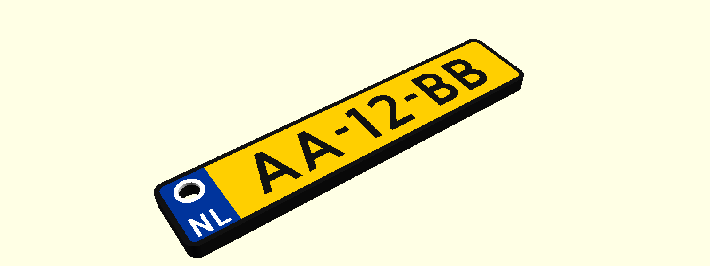
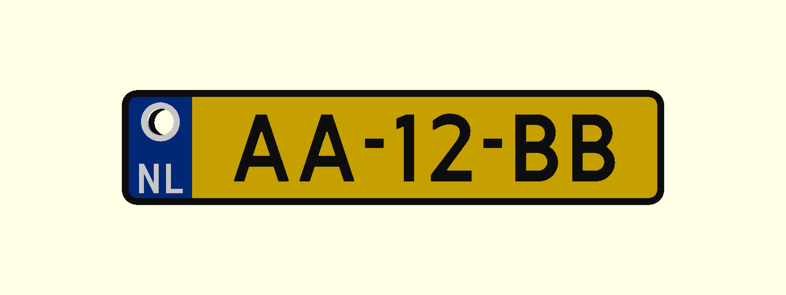

# Nederlands Kenteken Sleutelhanger (Dutch License Plate Keychain)

Een volledig parametrische, multi-color 3D-printbare Nederlandse kenteken sleutelhanger, ontworpen in **OpenSCAD** en 100% compatibel met de **MakerWorld Parametric Model Maker** en **Bambu Lab AMS**.




---

## Eigenschappen

- **MakerWorld Customizer Ready**: Gebruikers kunnen direct via hun browser op MakerWorld hun eigen kenteken invoeren, afmetingen instellen en een kant-en-klaar printbestand downloaden.
- **Echte Nederlandse Typografie**: Inclusief het officiële `Kenteken` (GAIK) font met uniforme, strakke letter- en cijfervormen, evenals de klassieke `Kenteken Smits 1951` en `2013` varianten.
- **Geoptimaliseerd voor FDM & AMS (Bambu Lab)**:
  - **Zwart** (`#111111`): Massieve achterkant, buitenrand om de plaat en de letters.
  - **Geel** (`#FFCC00`): Nederlands kentekenvlak.
  - **Blauw** (`#003399`): Europees vlak links, met afgeronde hoeken die meelopen met de buitenrand.
  - **Wit** (`#FFFFFF`): Stevige ring rondom het sleutelgat en de `NL` landcode.
- **Volledig Vlakke Toplaag (Flush Inlay)**: Alle kleuren liggen exact gelijk op 3.0 mm hoogte. Uitstekend geschikt voor prints met de voorkant op een *Textured PEI* of *Smooth PEI* plaat voor een spiegelglad of egaal mat resultaat zonder zichtbare laaglijnen.
- **Sleutelgat met Witte Ring**: Geplaatst op de plek van de voormalige EU-sterren; veel sterker en strakker te printen met een standaard 0.4 mm nozzle.
- **Gecentreerde Tekst**: Het kenteken is zowel horizontaal als verticaal exact uitgelijnd in het gele veld.

---

## Bestanden in deze repository

| Bestand | Omschrijving |
| :--- | :--- |
| `Kenteken_Sleutelhanger.scad` | Het parametrische OpenSCAD bronmodel (direct te uploaden naar MakerWorld). |
| `Kenteken_Sleutelhanger.3mf` | Native Bambu Studio projectbestand met de 4 AMS-kleuren (zonder gcode). |
| `generate_3mf.py` | Python script om automatisch een `.3mf` met Bambu Studio `paint_color` structuur te genereren. |
| `Kenteken.ttf` | Het moderne Nederlandse kentekenlettertype (GAIK). |
| `Kenteken Smits 1951.otf` | Historisch lettertype (ontwerp J.B. Smits 1951). |
| `Kenteken Smits 2013.otf` | Uitgebreide variant van het Smits lettertype. |
| `preview_top.png` / `preview_persp.png` | Voorbeeldafbeeldingen. |

---

## Gebruik & Aanpassen

### 1. Op MakerWorld (Webbrowser)
1. Upload `Kenteken_Sleutelhanger.scad` naar MakerWorld.
2. Bezoekers klikken op **"Customize"**.
3. Pas de parameters aan:
   - `kenteken_tekst`: Jouw kenteken (bijv. `12-AB-34`, `AA-12-BB` of `1-XYZ-23`).
   - `landcode`: Landcode onder het sleutelgat (standaard `NL`).
   - `landcode_grootte`: Grootte van de landcode (standaard 3.2 mm).
   - `plaat_lengte`, `plaat_hoogte`, `totale_dikte`: Afmetingen in mm.
4. Klik op **"Generate"** om de `.3mf` direct te downloaden.

### 2. Lokaal met Python (`generate_3mf.py`)
Je kunt direct vanuit de terminal een gepersonaliseerde `.3mf` genereren:

```bash
# Standaard genereren:
python3 generate_3mf.py

# Met een eigen kenteken:
python3 generate_3mf.py -D 'kenteken_tekst="99-XYZ-99"'
```

Het gegenereerde bestand `Kenteken_Sleutelhanger.3mf` kan direct worden geopend in Bambu Studio zonder pop-ups en met alle 4 de kleuren direct toegekend aan filament 1 t/m 4 van je AMS.

---

## Printinstellingen (Aanbevolen)

- **Nozzle**: 0.4 mm (of 0.2 mm voor extra scherpe tekst)
- **Laaghoogte**: 0.20 mm (eerste laag 0.20 mm)
- **Bouwoppervlak**: Textured PEI Plate
- **Oriëntatie**: Print met de tekstzijde naar beneden (*face down*) op het printbed voor het strakste resultaat.

---

## Licentie

- Code en 3D-modellen: [MIT License](LICENSE)
- Lettertypes: Creative Commons Attribution-ShareAlike 3.0 Unported (CC BY-SA 3.0) door LeFly Fonts (zie `FONTS_LICENSE.txt`).
